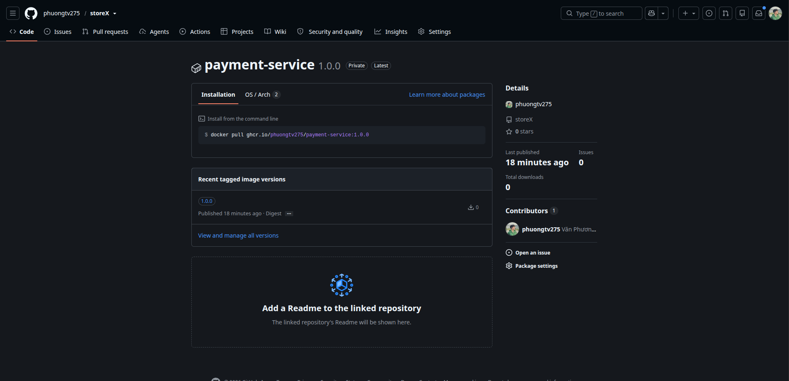

# Các bước đẩy image từ local lên GHCR

### Bước 1: tạo PAT
Để tạo PAT, hãy làm theo các bước sau: 
1. Đăng nhập tài khoản GitHub và vào Settings (nhấp vào ảnh đại diện ở góc trên bên phải).
2. Cuộn xuống cuối thanh bên trái và chọn Developer settings.
3. Chọn Personal access tokens > chọn Tokens (classic).
4. Nhấn Generate new token (classic).
5. Đặt tên gợi nhớ (Note), chọn thời hạn (Expiration) và cấp các quyền (Scopes hoặc Permissions) read/write package.
6. Nhấn Generate token và sao chép mã ngay lập tức vì GitHub chỉ hiển thị mã này một lần.

### Bước 2: Đăng nhập vào ghcr từ docker cli ở local
Mở terminal từ máy local và làm các bước: 
1. Export PAT đã tạo từ bước 1 vào biến môi trường. ``` export CR_PAT=ghp_***```
2. Tiến hành đăng nhập xác thực từ docker CLI. ```echo $CR_PAT | docker login ghcr.io -u phuongtv275 --password-stdin```

### Bước 3: Build Image cục bộ và gắn tag định dạng 1.0.0
Đứng tại thư mục gốc của project (storex), chạy: ```docker build -t ghcr.io/phuongtv275/payment-service:1.0.0 -f payment-service/Dockerfile ./payment-service```

### Bước 4: Push Image lên GHCR
Chạy lệnh sau để push image lên registry: ```docker push ghcr.io/phuongtv275/payment-service:1.0.0```

## Kết quả
Image `payment-service` hiển thị chính xác phiên bản `1.0.0` tại trang **Packages** trên Profile GitHub cá nhân.

Em đã link Image tới repo hiện tại. đường dẫn tới Package: https://github.com/phuongtv275/storeX/pkgs/container/payment-service